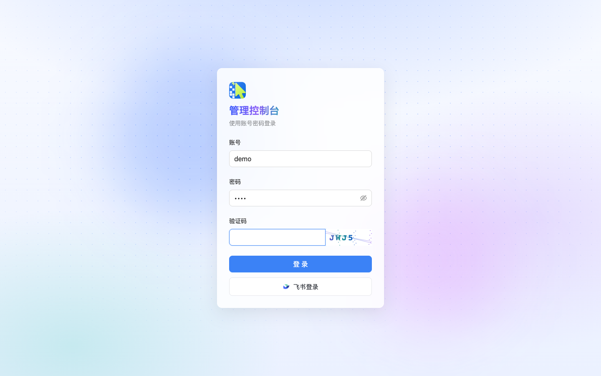
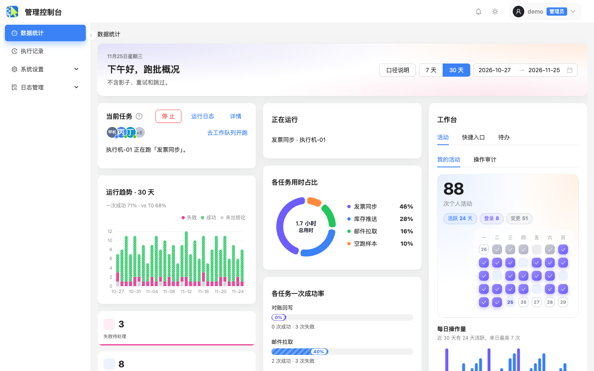

# ui-ux-next-kit

Cursor Agent Skill。同事打开本文件。Cursor 读 `SKILL.md`。写界面时的尺寸、文案、顺序和时长以 `references/public-components.md` 为准。

## 效果预览

`demo/console` 是按本规范做的演示（浅色主题，1440×900）。

在线体验：<https://zzl81cn.github.io/ui-ux-next-kit/>（账号 `demo`，密码已预填，验证码照图填；登录后进「数据统计」）。

契约自 0.0.5 起，登录页是极光画布（五层加两颗漂浮光球）、渐变标题、彩色验证码和跟随指针的光晕，数据统计在「当前任务」下面多一张「执行时间轴」。下面两张截图和 `demo/console` 已按这一版重做。在线演示要等 `main` 推送后由 Pages 重新部署才会更新。

| 登录页 | 数据统计 |
| --- | --- |
|  |  |

## 先看这里

| 谁 | 先打开 |
| --- | --- |
| 同事 | 本文件这一节 |
| Cursor | `SKILL.md`（放到 `.cursor/skills/ui-ux-next-kit` 后，说到还原或审计就会读） |
| 写某一页 | `references/public-components.md` 里那一节和它的验收清单 |

在要写界面的项目根目录安装：

```bash
npm install ui-ux-next-kit
```

安装后，技能挂在 `.cursor/skills/ui-ux-next-kit`，两条规则挂在 `.cursor/rules/`。规范改版后发布新版本，业务项目执行 `npm update ui-ux-next-kit` 即可。所有项目共用时：

```bash
npm install -g ui-ux-next-kit
```

全局安装只挂技能到 `~/.cursor/skills/`。项目规则仍随各项目的 `npm install` 写入。

同事在业务项目里执行上面的安装后，Cursor 会读到契约和规则。说到还原某一页或做审计时，读 `SKILL.md` 和 `references/public-components.md`。这和把规范交给同事用是同一件事。

`npm install` 装不到 `demo/console`。要打开可运行的演示，或让 Cursor 直接读演示源码，用本 Git 仓库。包里只有契约、规则、脚本和示例页。

还原一页时对 Agent 说：

```text
按 ui-ux-next-kit 还原这一页。先读 references/public-components.md 里对应的节，再读该节验收清单。
解剖表里的每一块都要出现。同一处写了多件事要一起做。
组件默认值不要盖过契约里的数字。对不上就改实现，不要改契约。
交卷时每条验收写「做到了」或「做不到」，做不到要写出缺的那个数字。
UI、UX 规范未尽事宜，严格按照 antd 的规范实现。
```

只审计、不改代码：「按 ui-ux-next-kit 做一次 UI/UX 审计」。报告写在目标项目根目录，文件名 `YYYYMMDD-[项目名]UI-UX审计报告.md`。

演示：

```bash
cd demo/console && pnpm install && pnpm dev
```

打开 `http://127.0.0.1:5174/#/login`。账号密码任意非空，验证码看图片上的字符。演示里的产品名是「管理控制台」，Logo 和 favicon 是套件自带的默认图。

演示里这两处还没对齐，不要当成契约：窄屏下的详情还没改成底部弹层（执行记录的「详情」已有 760px 抽屉，内容是简版字段表；数据统计「当前任务」的运行日志已有 960px 抽屉，窄屏同样还没改成底部弹层）。「管理机器人」穿梭弹层已按契约做了（执行机页点组内头像进入）。

## 发布和应用

当前发布版本是 `0.0.8`，页面是 https://www.npmjs.com/package/ui-ux-next-kit 。`latest` 指向这一版。注册表上的 `0.0.0-stage` 是 npm 的占位版本，不要安装，也不要删除。

Cursor 读的仍是 `SKILL.md`。npm 包负责把这份目录挂进项目，并让后续版本能被 `npm update` 拉下来。包里有契约、脚本、规则和示例。`demo/` 留在 Git 仓库，不进 npm 包。同事要看可运行的演示，克隆仓库后按下面的「演示」一节启动。

业务项目：

```bash
npm install ui-ux-next-kit
npm update ui-ux-next-kit
```

**发版：版本号由你指定，再执行命令。** 先把要发的改动提交到 `main`，再按你定的版本号（例如下一版 `0.0.9`）执行：

```bash
npm version 0.0.9 -m "Release %s."
git push origin main --follow-tags
npm publish
```

`npm version` 会改 `package.json`、用 `version` 脚本同步 `skill.json`、打出提交，并创建 `v0.0.9` 标签。推送带 `--follow-tags` 后，GitHub Actions 会按该标签自动生成 [GitHub Release](https://github.com/zzl81cn/ui-ux-next-kit/releases)；`npm publish` 仍需手动执行。不要用 `npm version patch` 自动加一档——版本号以你指定的为准。推送若改动了 `demo/console/**`，Pages 会同步更新在线演示。

两条规则是软链。要改某一条时，先删掉软链再放自己的文件，安装器看到普通文件就不会覆盖。

没有 `package.json` 的项目仍可用公共安装器，从 GitHub 拉取：

```bash
npx skills add zzl81cn/ui-ux-next-kit --skill ui-ux-next-kit --agent cursor
```

需要把版本钉死在某次提交时，继续用 Git 标签加 submodule：

```bash
git submodule add <git-url> .cursor/skills/ui-ux-next-kit
git -C .cursor/skills/ui-ux-next-kit checkout <tag>
mkdir -p .cursor/rules
cp .cursor/skills/ui-ux-next-kit/templates/cursor-rules/*.mdc .cursor/rules/
```

本机试用用软链，指到这份检出。升级时在 skill 仓库拉新标签，业务仓库更新 submodule 指针。压缩包只用于还没有 Git 的一次性传递，排除 `node_modules`、`dist`、`.DS_Store`。

技能正文不写公司名、产品名和镜像仓库地址。范本产品名留在来源仓库。本套件的站名是「管理控制台」，默认 Logo 是套件自带的图。

把《UI/UX 审计套件》打包成开源、可一键安装的 **Agent Skill Kit**：对前端项目做只读 UI/UX 审计，在**项目根目录**落盘结构化报告，并输出可直接交给修复 Agent 的分组 Prompt。

**Kit** 表示这是可扩展的工程资产包——当前主能力是审计与修复分组；后续可在同一仓库下增加脚手架、DESIGN 对齐检查等 Skill，而不改品牌名。

这样做不只是方便团队在多项目里复用同一套规则，也契合现代 **Agentic Engineering**（AI 辅助工程）的趋势——把审计基准、扫描脚本和防翻车修复 Prompt 沉淀成工程资产，而不是散落在对话里的一次性提示词。

命名里的 **Next** 表示面向现代栈。落地范本是参考控制台（`apps/console`：React 19 + Ant Design 6 + ProLayout），不是每个新项目再选一套「也是 React」。灵感来自开源 Agent Skill 形态（如 [ui-ux-pro-max-skill](https://github.com/nextlevelbuilder/ui-ux-pro-max-skill)），但本仓库聚焦 **审计 → 报告 → 修复分组 → 规则沉淀**，而不是设计灵感库。本仓库是模板，规范里不写具体公司或产品名。

曾用名 / 备选：`ui-ux-next-audit`（仍可作为触发别名）、`next-ui-governor`、`nextgen-ui-audit`、`ui-next-guard`。现统一为 **`ui-ux-next-kit`**。

## 功能

- 对照范本 **参考控制台** 定档（已是这套 / 另一套完整库 / 无组件库）。版本与「不要原样抄」的部分见 `references/exemplar-rpa-console.md`
- A–I 维度扫描：Token、组件、布局、三态、表格表单、文案、a11y、框架陷阱、工程卡口
- 可选静态扫描脚本（硬编码色、内联 style、`.ant-*` 覆盖、`z-index` 等）
- 报告落盘：`YYYYMMDD-[项目名]UI-UX审计报告.md`
- 分组修复 Prompt（防翻车底线：不改数据流、不重写整文件、不碰范围外页面）

## 工作流

Agent 读入本 Skill 的 `SKILL.md` 后，按四步执行（用户只需说「做一次 UI/UX 审计」一类意图即可触发）：

1. **确立基准**：读 `package.json` 定技术栈档位，对照 `references/tech-stacks.md` 和 `references/exemplar-rpa-console.md`（范本：参考控制台），检查全局 Token / 统一 Layout。
2. **只读审计**：跑 `scripts/` 或用 `rg` / Grep，按 `references/audit-dimensions.md` 扫 Token、原生控件混用、异步三态、全局 `.ant-*` 污染与 `z-index` 等。
3. **结构化报告**：严格按 `templates/report-template.md` 输出，划分 High / Medium / Low，并给出置信度；报告落在**被审计项目根目录**。
4. **拆解修复分组 (P1–Pn)**：按「能一起改、能一起验」打包独立修复 Prompt，套用 `templates/fix-prompts/` 中的防翻车底线。

## 目录

标准开源 Skill 布局（可发布到 GitHub，经 Git Submodule、软链或复制到 `.cursor/skills` 一键加载）：

```text
ui-ux-next-kit/                   # 仓库目录（Skill 名：ui-ux-next-kit）
├── SKILL.md                      # 核心引导与指令（Agent 识别的主协议）
├── skill.json
├── README.md                     # 给人看的安装与使用说明
├── LICENSE                       # MIT
├── references/                   # 运行时参考基准
│   ├── tech-stacks.md            # 组织推荐栈与档位映射
│   ├── exemplar-rpa-console.md   # 参考控制台范本与不要原样抄的部分
│   ├── exemplar-rpa-architecture.md # 可选：同仓、前后端分离
│   ├── exemplar-deploy.md        # 默认发版：Jenkins 构建，Docker 上线
│   ├── public-components.md      # 界面契约（筛选、满高表、部门树、登录、看板、壳、设置、详情、手机壳）
│   ├── figma-handoff.md          # Figma 若是 Arco：手绘规格 + antd v6，不硬套
│   ├── audit-dimensions.md       # A–I 维度判定与红线
│   └── rules-sediment.md         # 规则沉淀说明
├── demo/
│   └── console/                  # 按规范跑起来的前端演示（本地 mock，不带公司名）
├── scripts/                      # 静态检索引擎
│   ├── check-tokens.sh           # 硬编码色、内联 style 等
│   ├── check-globals.sh          # 全局类名污染、z-index 等
│   ├── run-all.sh
│   └── lib.sh
└── templates/                    # 强结构化输出
    ├── report-template.md        # 审计报告模板
    ├── cursor-rules/             # 实施时复制到目标项目 .cursor/rules/
    │   ├── frontend-stack.mdc    # 框架版本与 antd 6 API（源自范本 console-antd-v6）
    │   └── figma-handoff.mdc     # 预防：Arco 不硬套，token 对齐，保留 antd 交互
    └── fix-prompts/              # 分组修复 Prompt（含防翻车底线）
        ├── base.md
        ├── P-A-tokens.md
        ├── P-D-states.md
        └── P-H-globals.md
```

安装、还原和演示见上面「先看这里」。旧名 `ui-ux-next-audit` 仍可作为触发别名。

手动扫描（在目标项目根）：

```bash
bash /path/to/ui-ux-next-kit/scripts/run-all.sh
```

正式发版不走上面这条开发命令。默认 Jenkins 构建 `demo/console` 的镜像，目标机用 `docker compose -f docker-compose.prod.yml` 拉起。任务脚本是 `demo/console/jenkins/Jenkinsfile`，说明在 `references/exemplar-deploy.md`。

## 依赖

扫描脚本需要 [ripgrep](https://github.com/BurntSushi/ripgrep)（`brew install ripgrep`）。Agent 也可用内置 Grep 工具代替脚本。

## License

MIT · `0.1.0`
